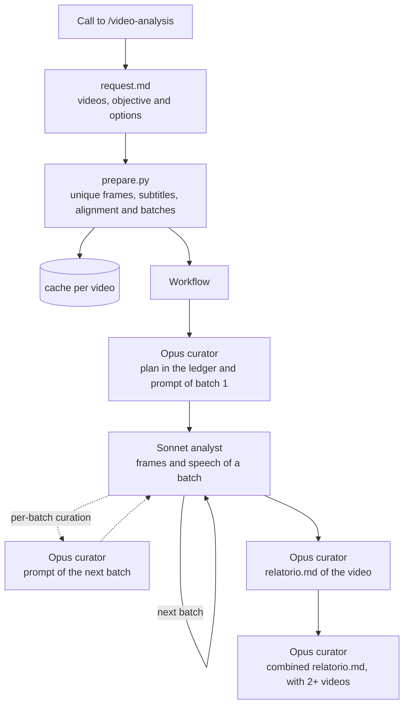

# video-analysis

A Claude Code skill that analyses videos frame by frame against the subtitles: screen recordings, recorded
meetings (Teams, Zoom) and lectures with slides. You give an objective, such as "list the decisions and
who is responsible" or "what is on the screen when they talk about the error?", and you get a report per
video in which each finding points to the frame and the time that support it.

**Version 1.0.0** · Windows · Python 3.10+ · ffmpeg · Claude Code with the Workflow tool

The command-line options, the request file (`request.md`), the `resume` keyword and the file names of the
skill are in English. The Portuguese names of the earlier version still work (`--max-lotes`, `--papeis`,
`retomar`, `pedido.md`, `# objetivo`, `verificar_ambiente.py`…). The run files (`relatorio.md`, the ledger)
and the templates of the reports stay in Portuguese. Reports are written in the language of the objective
(`--language` overrides it; pt-BR when in doubt).

## Overview

- Extracts only the unique frames of the video. Cursor motion, tooltips and clocks do not count, and a
  screen that comes back is reused instead of becoming a new frame.
- Reads the `.vtt` subtitles of the same name (WhisperX, Teams or plain) and links each frame to the speech
  in the interval it represents.
- Splits each video into batches of up to 20 frames. A curator (Opus) plans the batches and an analyst
  (Sonnet) examines each one, in series.
- Delivers a `relatorio.md` per video and, with two or more videos, a combined report.
- Keeps frames, subtitles and batches in a cache: a new question about the same video extracts nothing again.
- With the optional DeepFace environment, leaves each webcam out of the comparison only while it is on
  screen, so a call whose layout changes yields fewer frames that only show someone moving.

## How it works

The skill has two layers.

1. **Deterministic** (`scripts/`, Python). `prepare.py` decodes the video once with ffmpeg, at 2 frames
   per second, and compares each sample, in grayscale and 360 px high, with the last frame kept. Only
   what really changed stays, each frame with the time interval it represents and a JPEG whose longer
   side is 1568 px. Then it reads the subtitles, fixes and merges the cues, aligns the cues to the frames
   and writes the batches: the timeline of each batch (`batch_NNN.md`), a contact sheet of thumbnails and
   the transcript. Before the extraction, when the optional DeepFace environment exists, it finds the
   webcams with `scripts/webcam_mask.py` and masks each one only while it is on screen (the webcam
   timeline).
2. **Agentic** (`workflow/` and `agents/`). A Claude Code Workflow runs the batches of each video in
   series, with up to 3 videos in parallel. The curator reads the objective and the transcript, records
   the plan in a ledger and writes the prompt of the first batch. The analyst opens all the images of a
   batch, cross-checks them with the speech and writes the batch report. At the end, the curator writes
   the video's report and, with two or more videos, the synthesis.



The design saves tokens in three places:

- The main agent never opens frames, batches or batch reports. It only sees the JSON from `prepare.py`
  and the final summaries.
- Only unique frames go to analysis. In the project's measurements, 66% to 91% of the samples were
  discarded.
- The transcript is read once, by the curator, and summarized in the ledger.

Each video uses one analyst per batch, plus the plan and the report; with two or more videos, one more
agent writes the combined report. With `--curation batches`, the curator also writes the prompt of each
following batch, which costs about twice as much. Above 80 agents, the skill asks before going on;
above 800, it refuses the run.

## Requirements

| item | version | what for |
|---|---|---|
| Windows | developed on Windows 11 | the skill's paths, permissions and messages are for Windows |
| Claude Code | with skills and the Workflow tool | without Workflow, the skill runs the same loop with the Agent tool ([`reference/without-workflow.md`](reference/without-workflow.md)) |
| Python | 3.10 or newer (tested on 3.14) | deterministic layer |
| ffmpeg and ffprobe | on the PATH (tested on 8.1) | probing and frame extraction |
| numpy and Pillow | any recent version | frame comparison and images; the skill itself does not use OpenCV |
| DeepFace (optional) | 0.0.104, in its own Python environment (about 350 MB) | the webcam timeline; the setup creates it if you want it |
| Node.js | 24 | only for the workflow tests |
| pytest | any recent version | only for the tests |

## Installation

1. Clone the repository into the Claude Code skills folder. The folder must be named `video-analysis`:

   ```powershell
   git clone https://github.com/rmmaf/video-analysis-skill.git "$env:USERPROFILE\.claude\skills\video-analysis"
   ```

2. In Claude Code, run the setup:

   ```text
   /video-analysis setup
   ```

   The setup runs `check_environment.py` and handles one item at a time: Python, ffmpeg, numpy and
   Pillow, the central folder, the agents and the workflow, the permission rules and, if you want it, the
   DeepFace environment of the webcam timeline. Nothing is installed or written without your confirmation.
   Outside the central folder, it writes to these places (the last row only if you accept DeepFace):

   | what | where | how to undo |
   |---|---|---|
   | the curator and analyst roles | `%USERPROFILE%\.claude\agents\video-analysis-*.md` | delete the two files |
   | the saved workflow | `%USERPROFILE%\.claude\workflows\video-analysis.js` | delete the file |
   | the permission rules for the central folder | `%USERPROFILE%\.claude\settings.json` | restore the `settings.json.bak-<date>` |
   | the DeepFace environment and the YuNet weights | `%USERPROFILE%\deepface-env\` and `%USERPROFILE%\.deepface\weights\face_detection_yunet_2023mar.onnx` | delete the folder and the file |

3. Close and reopen Claude Code, so that it loads the agents and the workflow. Start with a short
   analysis, with `--max-batches 1`: it confirms that the run does not ask for permission at every frame.

**To update**, pull the changes and run the setup again, which copies the agents and the workflow again
when they have changed:

```powershell
git -C "$env:USERPROFILE\.claude\skills\video-analysis" pull
```

## Usage

In the Claude Code conversation:

```text
/video-analysis "C:\Videos\reuniao.mp4" Liste as decisões tomadas e quem ficou responsável por cada uma
/video-analysis "C:\Videos\aulas" Resuma cada aula em passos numerados --max-batches 2
/video-analysis "C:\Videos\demo.mp4" Que erro aparece na tela quando falam do deploy? --range 00:10:00-00:20:00
/video-analysis resume
```

- Each video needs a `.vtt` subtitle file with the same name, in the same folder: `reuniao.mp4` uses
  `reuniao.vtt`.
- Accepted formats: `.mp4`, `.mkv`, `.mov`, `.webm`, `.m4v`, `.avi`, `.wmv`, `.mpg`, `.mpeg`, `.ts`,
  `.m2ts` and `.flv`.
- Put the path in quotes. That way the skill recognizes folders and names with spaces.

What happens after the call:

1. The skill writes the request and estimates the extraction time.
2. `prepare.py` extracts frames, subtitles and batches, or reuses them from the cache, and computes how
   many agents the run will use. With more than 80, the skill asks before launching the Workflow.
3. The Workflow runs in the background, at about 4 minutes per batch, and lets you know when it finishes.
4. The skill shows the summary of each video and the path of the reports.

`/video-analysis resume` (also `retomar`) continues an interrupted run (Claude Code closed, quota, error)
from where it stopped.

### Options

| option | default | effect |
|---|---|---|
| `--max-batches N` | all | only batches 1 to N of each video, to test the objective |
| `--range hh:mm:ss-hh:mm:ss` | whole video | only that segment, with its own batches |
| `--parallel N` | `3` | videos in parallel; use `1` against rate limits |
| `--curation plan\|batches` | `plan` | `batches`: curator before each batch, carrying the context forward (≈ 2× the cost) |
| `--analyst-effort low\|medium\|high` | `high` | analyst effort; `medium` costs ~13% less and answers less completely |
| `--curator-effort low\|medium\|high` | `high` | curator effort in the batches, only with `--curation batches` |
| `--roles agents\|inline` | automatic | `agents` uses the installed agents; `inline` passes the roles in the prompt and costs a little more |
| `--language xx` | the objective's | language of the reports |
| `--speakers "SPEAKER_01=Name;…"` | — | real names of the speakers in the subtitles |
| `--sensitivity low\|normal\|high` | `normal` | `high` catches smaller changes and produces more frames |
| `--ignore-region x,y,w,h` | — | region of the frame, in fractions, left out of the comparison: webcam, clock |
| `--ignore-timeline FILE.json` | — | regions left out only during spans of the video: a webcam that comes and goes with the layout (`scripts/webcam_mask.py --timeline`); it prevails over the automatic timeline of that video, even without spans |
| `--webcam-timeline auto\|on\|off` | `auto` | with the DeepFace environment, the webcam timeline made before the extraction: `auto` probes the video and runs the full scan only if a face shows up (about 24 min per hour of 1080p video, once per video); `on` always runs the full scan; `off` never |

When to change each one and what it costs: [`reference/parameters.md`](reference/parameters.md).

### Outputs

```text
%USERPROFILE%\video-analysis\
├── cache\<slug>-<fp8>\              subtitles, frames, batches and webcam timeline of each video, reused across runs
├── runs\<YYYYMMDD-HHMMSS>-<slug>\
│   ├── relatorio.md                 combined report, with 2+ videos
│   └── v1\                          the video's relatorio.md, ledger.md, prompts\ and reports\
├── requests\                        request of the analysis in progress
├── roles\                           copy of the roles for inline mode
└── logs\
```

The agents only read the cache and only write to `runs\`. Moving, renaming or editing a video causes it
to be extracted again; changing the objective does not.

## Command-line tools

For manual use, without Claude, from the skill folder:

```powershell
python scripts/prepare.py "C:\Videos\reuniao.mp4"                      # only warms up the cache
python scripts/prepare.py --gc 30                                       # deletes from the cache the videos unused for 30 days
python scripts/explain.py --frames-json <frames.json> --frame F0042     # why this frame was kept
python scripts/calibrate.py "C:\Videos\reuniao.mp4" --grid "sensitivity=normal,high"   # compares parameters
python check_environment.py                                            # checks the environment, without changing anything
%USERPROFILE%\deepface-env\Scripts\python scripts/webcam_mask.py "C:\Videos\reuniao.mp4" --timeline webcam.json   # webcam over time by hand (prepare.py already runs it)
```

`python scripts/prepare.py --help` lists all the options. The `frames.json` of a video is in
`cache\<slug>-<fp8>\frames-<h8>\`.

## Tests

Run from the skill folder:

```powershell
python -B -m pytest -q                  # unit tests and synthetic videos
python -B -m pytest -q --run-real       # includes the real videos of tests/fixtures.json
python -B -m pytest -q --run-slow       # includes the performance tests
node tests/harness.mjs                  # the workflow, with simulated agents
python tests/check_run.py <run_dir>     # checks a finished run
```

- `-B` and `pytest.ini` keep `__pycache__` and `.pytest_cache` out of the skill folder.
- `--run-real` and `--run-slow` can also be turned on with `VA_RUN_REAL=1` and `VA_RUN_SLOW=1`.
- The synthetic videos (`tests/synth.py`) are generated with Pillow and x264, with ground truth, and are
  cached in `%TEMP%\va-synth-v<N>` (or in `VA_SYNTH_DIR`).
- `harness.mjs` runs `workflow/video-analysis.js` with simulated agents: happy path, a batch that skips
  frames, failures, resume, several videos and the two role modes. It has no dependencies.
- `check_run.py` checks the ledger, whether the prompts cite the batches without copying cues, whether
  the reports cover all the frames and whether the final report answers the objective. The ledger and
  prompt checks follow the run's curation (`options.curation`). With the default `plan`,
  `Integrado até o lote` can go from `000`, as the INIT writes it, up to the last batch analysed, and only
  the prompt of batch 1 is required; those of the other batches are checked when they exist. With
  `--curation batches`, the ledger must be integrated up to the second-to-last or the last batch analysed,
  and each batch needs its own prompt. A run without `options.curation` predates the option, had the NEXT
  and is checked as `batches`.
- `tests/test_vtt.py` and `tests/test_data_files.py` read real subtitle excerpts that are kept out of git
  (see [Data and privacy](#data-and-privacy)). In a fresh clone, these tests fail because the files are
  missing.

## Troubleshooting

`prepare.py` tells what happened through its exit code:

| exit code | meaning |
|---|---|
| `0` | ok, sometimes with warnings |
| `2` | input: video or subtitles not found, invalid request or option, run too large |
| `3` | environment: ffmpeg, ffprobe, Python, numpy or Pillow missing; run `/video-analysis setup` |
| `4` | a video failed; the others go on |
| `130` | interrupted; what was completed stays in the cache |
| `1` | internal error; the traceback goes to `logs\` |

Symptoms, causes and fixes, including permissions, agents and Workflow:
[`reference/troubleshooting.md`](reference/troubleshooting.md).

## Data and privacy

- The skill uses no secrets and no login: it works with local files, ffmpeg and Python. The optional
  DeepFace environment comes from PyPI, and the setup also downloads the YuNet weights (about 230 KB, from
  OpenCV's model repository on GitHub, checked by their SHA-256), so that an analysis does not have to.
- The agents do not copy sensitive values that appear on the screen or in the speech, such as a password,
  token, key, connection string, CPF, phone number or personal e-mail. They record only that the data
  appeared, in which frame and at what time.
- The real meeting excerpts used in the tests are kept out of git by `.gitignore`: the subtitles in
  `tests/data/vtt/`, except the synthetic `edge_cases.vtt`, and the aligned transcript in
  `docs/prior-art/da_1608/`. They exist only on the original machine; the rule is in
  [`tests/data/vtt/README.md`](tests/data/vtt/README.md).
- `.gitattributes` turns off line-ending conversion for the `.vtt` files, which the tests read byte by byte.

## Known limitations

- **Windows only.** The setup and the paths assume Windows, but any Windows user can install the
  skill: the docs name paths as `%USERPROFILE%\...`, the scripts find the folders through
  `%USERPROFILE%`, `VIDEO_ANALYSIS_HOME` (central folder) and `VA_CLAUDE_HOME` (Claude Code folder),
  and `check_environment.py` prints the concrete paths.
- **A change of color alone does not become a frame.** The comparison is in grayscale: a new color with
  the same brightness goes unnoticed.
- **Tiny changes can be mistaken for the cursor.** A digit or a few letters may not become a frame;
  `--sensitivity high` reduces this.
- **Long videos are expensive and slow.** A 55-minute meeting yields about 50 batches, and the batches of
  a video run in series. Use `--range` or `--max-batches`.
- **No subtitles, no analysis.** Without the `.vtt` of the same name, `prepare.py` stops, shows the
  candidate files and suggests the command to rename.

## Next steps

Out of scope for version 1, according to the [plan](docs/plan.md):

- coverage by relevance: the curator skips batches unrelated to the objective, the biggest gain in long meetings;
- curation every 2 batches in homogeneous segments;
- parallel chapters for a long video;
- native-resolution crops for tiny text;
- comparison in color too;
- packaging as a plugin, to register the agents without copying files or restarting Claude Code.

## Versions

| component | version | constant in `scripts/va/__init__.py` |
|---|---|---|
| skill | `1.0.0` | `VERSION` |
| frame extraction and deduplication | `dedup-1.1` | `ALGO_VERSION` |
| subtitle parser | `vtt-1.0` | `PARSER_VERSION` |
| alignment, batches and rendering | `render-1.1` | `RENDER_VERSION` |
| webcam timeline | `webcam-1.1` | `WEBCAM_VERSION` |
| `workflow_args` contract | `1` | `SCHEMA_VERSION` |

The stage versions go into the cache keys: changing one of them redoes only the affected stage and the
following ones.

## Documentation

| file | contents |
|---|---|
| [`SKILL.md`](SKILL.md) | instructions that Claude follows when calling the skill |
| [`setup.md`](setup.md) | procedure for `/video-analysis setup` |
| [`reference/contracts.md`](reference/contracts.md) | formats of the request, of the `prepare.py` stdout, of the `workflow_args` and of the central folder |
| [`reference/parameters.md`](reference/parameters.md) | what each parameter does and when to change it |
| [`reference/troubleshooting.md`](reference/troubleshooting.md) | symptom, cause and what to do |
| [`reference/without-workflow.md`](reference/without-workflow.md) | the same loop with the Agent tool, without Workflow |
| [`docs/plan.md`](docs/plan.md) | plan, architecture and implementation errata |
| [`docs/design-deterministic.md`](docs/design-deterministic.md) | specification of the deterministic layer |
| [`docs/design-agentic.md`](docs/design-agentic.md) | specification of the agentic layer |
| [`tests/data/calibration.md`](tests/data/calibration.md) | measurements that calibrated the parameters |

## Repository structure

```text
video-analysis/
├── SKILL.md                 the skill's instructions for Claude Code
├── setup.md                 setup procedure
├── check_environment.py    checks Python, ffmpeg, agents, workflow, permissions and the optional DeepFace
├── agents/                  roles of the curator (Opus) and the analyst (Sonnet)
├── workflow/                video-analysis.js, the Workflow script
├── scripts/
│   ├── prepare.py           command line of the deterministic layer
│   ├── calibrate.py         parameter sweep of the frame engine
│   ├── explain.py           panel showing why a frame was kept or ignored
│   ├── webcam_mask.py       webcam regions (fixed or over time) with DeepFace, in a separate environment;
│   │                        prepare.py runs it before the extraction
│   └── va/                  extraction, deduplication, subtitles, alignment, batches, cache and runs
├── reference/               contracts, parameters, troubleshooting and the procedure without Workflow
├── docs/                    plan, specifications and the earlier prototype (prior-art)
└── tests/                   pytest, synthetic videos, workflow harness and test data
```

## License

Private repository, for personal use. No license is defined: without a `LICENSE` file, all rights remain
with the author.
