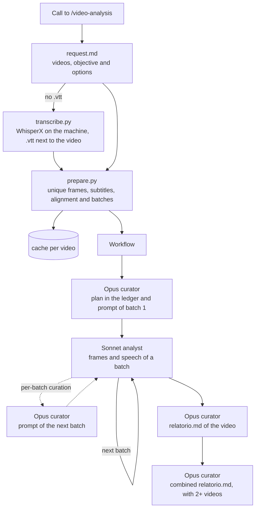

# video-analysis

A Claude Code skill that analyses videos frame by frame against the subtitles: screen recordings, recorded
meetings (Teams, Zoom) and lectures with slides. You give an objective, such as "list the decisions and
who is responsible" or "what is on the screen when they talk about the error?", and you get a report per
video in which each finding points to the frame and the time that support it.

**Version 1.1.0** · Windows, or macOS on Apple silicon · Python 3.10+ · ffmpeg · Claude Code with the
Workflow tool

The command-line options, the request file (`request.md`), the `resume` keyword and the file names of the
skill are in English. The Portuguese names of the earlier version still work (`--max-lotes`, `--papeis`,
`retomar`, `pedido.md`, `# objetivo`, `verificar_ambiente.py`…). The run files (`relatorio.md`, the ledger)
and the templates of the reports stay in Portuguese. Reports are written in the language of the objective
(`--language` overrides it; pt-BR when in doubt).

## Overview

- Extracts only the unique frames of the video. Cursor motion, tooltips and clocks do not count, and a
  screen that comes back is reused instead of becoming a new frame.
- Reads the `.vtt` subtitles of the same name (WhisperX, Teams or plain) and links each frame to the speech
  in the interval it represents.
- Without subtitles, transcribes the video on the machine with WhisperX, after asking how many people
  speak: the speech, the time of each word and, with a free Hugging Face token, who speaks. The `.vtt`
  stays next to the video, so the next analysis asks nothing. No Docker: a Python environment of its own,
  on Windows and on Macs with Apple silicon.
- Splits each video into batches of up to 20 frames. A curator (Opus) plans the batches and an analyst
  (Sonnet) examines each one, in series.
- Delivers a `relatorio.md` per video and, with two or more videos, a combined report.
- Keeps frames, subtitles and batches in a cache: a new question about the same video extracts nothing again.
- With the optional DeepFace environment, leaves each webcam out of the comparison only while it is on
  screen, so a call whose layout changes yields fewer frames that only show someone moving.

## How it works

The skill has two layers.

1. **Deterministic** (`scripts/`, Python). A video without subtitles is transcribed first by
   `scripts/transcribe.py`, which runs WhisperX in its own Python environment (`whisperx-env`, made by the
   setup): Whisper in blocks of about 10 minutes, each one a checkpoint, then the time of each word and
   the speakers (pyannote); `prepare.py` writes the result as a `.vtt` next to the video (on a Mac:
   [What runs where on Apple silicon](#what-runs-where-on-apple-silicon)). Then
   `prepare.py` decodes the video once with ffmpeg, at 2 frames per second, and compares each sample, in
   grayscale and 360 px high, with the last frame kept. Only
   what really changed stays, each frame with the time interval it represents and a JPEG whose longer
   side is 1568 px. Then it reads the subtitles, fixes and merges the cues, aligns the cues to the frames
   and writes the batches: the timeline of each batch (`batch_NNN.md`), a contact sheet of thumbnails and
   the transcript. Before the extraction, when the optional DeepFace environment exists, it finds the
   webcams with `scripts/webcam_mask.py` and masks each one only while it is on screen (the webcam
   timeline).
2. **Agentic** (`workflow/` and `agents/`). A Claude Code Workflow runs the batches of each video in
   series, with up to 3 videos in parallel. The curator reads the objective and the transcript, records
   the plan in a ledger and writes the prompt of the first batch. The analyst opens all the images of a
   batch, cross-checks them with the speech and writes the batch report. At the end, the curator writes
   the video's report and, with two or more videos, the synthesis.



The design saves tokens in three places:

- The main agent never opens frames, batches or batch reports. It only sees the JSON from `prepare.py`
  and the final summaries.
- Only unique frames go to analysis. The September prototype discarded 66% to 91% of the samples; the
  current engine, with the default masks, discarded 95% to 96% on two meetings
  ([Frame reduction on two meetings](#frame-reduction-on-two-meetings)).
- The transcript is read once, by the curator, and summarized in the ledger.

Each video uses one analyst per batch, plus the plan and the report; with two or more videos, one more
agent writes the combined report. With `--curation batches`, the curator also writes the prompt of each
following batch, which costs about twice as much. Above 80 agents, the skill asks before going on;
above 800, it refuses the run.

## Requirements

| item | version | what for |
|---|---|---|
| Windows or macOS | developed on Windows 11; macOS on Apple silicon, with Homebrew | the skill and the local transcription; an Intel Mac runs the skill only with `.vtt` subtitles (PyTorch 2.8 has no Intel macOS build) |
| Claude Code | with skills and the Workflow tool | without Workflow, the skill runs the same loop with the Agent tool ([`reference/without-workflow.md`](reference/without-workflow.md)) |
| Python | 3.10 or newer (tested on 3.14); on macOS, Homebrew's `python3`, not Apple's `/usr/bin/python3` (3.9) | deterministic layer |
| ffmpeg and ffprobe | on the PATH (tested on 8.1) | probing and frame extraction |
| numpy and Pillow | any recent version | frame comparison and images; the skill itself does not use OpenCV |
| WhisperX | 3.8.6 with PyTorch 2.8, in its own Python 3.12 environment (about 6.5 GB with the models, without NVIDIA) | the transcription of a video without subtitles; the setup creates it with uv |
| uv | any recent version | creates that environment and brings its Python; the setup installs it when missing |
| Hugging Face token (optional) | a free Read token, with the conditions of `pyannote/speaker-diarization-community-1` accepted | separating the speakers in the transcription |
| DeepFace (optional) | 0.0.104, in its own Python environment (about 350 MB) | the webcam timeline; the setup creates it if you want it |
| Node.js | 24 | only for the workflow tests |
| pytest | any recent version | only for the tests |

## Installation

1. Clone the repository into the Claude Code skills folder. The folder must be named `video-analysis`:

   ```powershell
   git clone https://github.com/rmmaf/video-analysis-skill.git "$env:USERPROFILE\.claude\skills\video-analysis"
   ```

   On macOS, in Terminal (zsh):

   ```zsh
   git clone https://github.com/rmmaf/video-analysis-skill.git ~/.claude/skills/video-analysis
   ```

2. In Claude Code, run the setup:

   ```text
   /video-analysis setup
   ```

   The setup runs `check_environment.py` and handles one item at a time: Python, ffmpeg, numpy and
   Pillow, the central folder, the agents and the workflow, the permission rules, the transcription
   environment and, if you want them, the Hugging Face token that separates the speakers and the DeepFace
   environment of the webcam timeline. Nothing is installed or written without your confirmation, and the
   token you save yourself, in your own terminal. Outside the central folder, it writes to these places:

   | what | where | how to undo |
   |---|---|---|
   | the curator and analyst roles | `%USERPROFILE%\.claude\agents\video-analysis-*.md` | delete the two files |
   | the saved workflow | `%USERPROFILE%\.claude\workflows\video-analysis.js` | delete the file |
   | the permission rules for the central folder | `%USERPROFILE%\.claude\settings.json` | restore the `settings.json.bak-<date>` |
   | the transcription environment | `%USERPROFILE%\whisperx-env\` | delete the folder |
   | uv, its Python 3.12 and its package cache | `pip install --user uv`; `uv python dir`; `uv cache dir` | `uv python uninstall 3.12`, `uv cache clean`, `python -m pip uninstall uv` |
   | the Whisper, alignment and pyannote models | `%USERPROFILE%\.cache\huggingface\hub\` | delete their `models--*` folders |
   | the Hugging Face token (you save it) | `%USERPROFILE%\.cache\huggingface\token` | `hf auth logout` |
   | the DeepFace environment and the YuNet weights | `%USERPROFILE%\deepface-env\` and `%USERPROFILE%\.deepface\weights\face_detection_yunet_2023mar.onnx` | delete the folder and the file |

   On macOS the same places are under `~` (`~/.claude/agents/`, `~/whisperx-env/`, `~/.cache/huggingface/`,
   `~/deepface-env/`…), and uv comes from Homebrew (`brew install uv`; undone with `brew uninstall uv`). To
   undo it there, in zsh:

   ```zsh
   ~/whisperx-env/bin/hf auth logout       # only if you saved a token; before deleting the environment
   rm ~/.claude/agents/video-analysis-*.md ~/.claude/workflows/video-analysis.js
   rm -rf ~/whisperx-env ~/deepface-env ~/.deepface/weights/face_detection_yunet_2023mar.onnx
   rm -rf ~/.claude/skills/video-analysis  # the skill itself
   ```

   The models stay in `~/.cache/huggingface/hub/` (delete their `models--*` folders; the cache may hold
   other programs' models), and the permission rules in `~/.claude/settings.json` until you restore its
   `settings.json.bak-<date>`.

3. Close and reopen Claude Code, so that it loads the agents and the workflow. Start with a short
   analysis, with `--max-batches 1`: it confirms that the run does not ask for permission at every frame.

**To update**, pull the changes and run the setup again, which copies the agents and the workflow again
when they have changed:

```powershell
git -C "$env:USERPROFILE\.claude\skills\video-analysis" pull
```

```zsh
git -C ~/.claude/skills/video-analysis pull       # macOS
```

## Usage

In the Claude Code conversation:

```text
/video-analysis "C:\Videos\reuniao.mp4" Liste as decisões tomadas e quem ficou responsável por cada uma
/video-analysis "C:\Videos\aulas" Resuma cada aula em passos numerados --max-batches 2
/video-analysis "C:\Videos\demo.mp4" Que erro aparece na tela quando falam do deploy? --range 00:10:00-00:20:00
/video-analysis resume
```

On macOS, with POSIX paths:

```text
/video-analysis "/Users/<user>/Movies/reuniao.mp4" Liste as decisões tomadas e quem ficou responsável por cada uma
/video-analysis "/Volumes/SSD/aulas" Resuma cada aula em passos numerados --max-batches 2
```

- A video with a `.vtt` subtitle file of the same name, in the same folder, uses it: `reuniao.mp4` uses
  `reuniao.vtt`. Without one, the skill asks how many people speak and transcribes the video on the
  machine, saving `reuniao.vtt` next to it. Say the number in the call (`são 3 pessoas`, or
  `--num-speakers 3`) and nobody is asked; answer `Não sei` and an agent counts the people in 12
  screenshots of the video (who is seen speaking, how many are in the meeting) and gives pyannote that
  range.
- Accepted formats: `.mp4`, `.mkv`, `.mov`, `.webm`, `.m4v`, `.avi`, `.wmv`, `.mpg`, `.mpeg`, `.ts`,
  `.m2ts` and `.flv`.
- Put the path in quotes. That way the skill recognizes folders and names with spaces.

What happens after the call:

1. The skill writes the request and estimates the extraction time. A video without subtitles gets a
   question: how many people speak in it?
2. `prepare.py` transcribes the videos without subtitles (on a CPU, slowly: 25 min for a 9-min meeting on
   a 2017 laptop; once per video; faster on Apple silicon, below), extracts frames, subtitles and batches, or reuses them from the cache, and computes how many
   agents the run will use. With more than 80, the skill asks before launching the Workflow.
3. The Workflow runs in the background, at about 4 minutes per batch, and lets you know when it finishes.
4. The skill shows the summary of each video and the path of the reports.

`/video-analysis resume` (also `retomar`) continues an interrupted run (Claude Code closed, quota, error)
from where it stopped.

### What runs where on Apple silicon

On a Mac with Apple silicon (an M4 Max, say) the transcription runs natively, without Rosetta:

- **The speech** (Whisper, through CTranslate2, `int8`) runs on the CPU, with one thread per
  **performance core** (`sysctl -n hw.perflevel0.physicalcpu`: 10 or 12 on an M4 Max). A thread pool that
  included the efficiency cores would run at the speed of the slowest one.
- **The time of each word** (wav2vec2) and **the speakers** (pyannote) run on the GPU through **MPS**,
  PyTorch's Metal backend. A phase that fails on MPS is retried once on the CPU, and `transcribe.log` says
  so (`alignment on mps failed (…): retrying on the cpu`).
- **Experimental:** `VA_ASR_DEVICE=mps` runs the speech on CTranslate2's Metal backend too (`float16`),
  falling back to the CPU (`int8`) with a warning when it does not load, runs out of memory or fails
  ([`setup.md`](setup.md), step 6).
- **Intel Macs** cannot transcribe: PyTorch 2.8 has no Intel macOS build, so every video there needs its
  `.vtt`.

None of this has been measured on a Mac yet: the time the estimate gives there is a guess until it is
calibrated (`TRANSCRIBE_DEFAULTS["cost"]["apple"]`).

### Options

| option | default | effect |
|---|---|---|
| `--max-batches N` | all | only batches 1 to N of each video, to test the objective |
| `--range hh:mm:ss-hh:mm:ss` | whole video | only that segment, with its own batches |
| `--parallel N` | `3` | videos in parallel; use `1` against rate limits |
| `--curation plan\|batches` | `plan` | `batches`: curator before each batch, carrying the context forward (≈ 2× the cost) |
| `--analyst-effort low\|medium\|high` | `high` | analyst effort; `medium` costs ~13% less and answers less completely |
| `--curator-effort low\|medium\|high` | `high` | curator effort in the batches, only with `--curation batches` |
| `--roles agents\|inline` | automatic | `agents` uses the installed agents; `inline` passes the roles in the prompt and costs a little more |
| `--language xx` | the objective's | language of the reports |
| `--speakers "SPEAKER_01=Name;…"` | — | real names of the speakers in the subtitles |
| `--num-speakers N` | asked | how many people speak, for a video the skill transcribes: `3`, `2-4`, `4+`, `auto`, or `1` (no speaker separation); per video, `v1=3; v2=auto` |
| `--whisper-model NAME` | by hardware | Whisper model of the transcription: `large-v3-turbo` on a CPU and on a Mac, `large-v3` on an NVIDIA GPU (GTX 9xx/10xx use the CPU) |
| `--audio-language xx` | `auto` | language spoken in the video, for the transcription; detected over the speech by default |
| `--sensitivity low\|normal\|high` | `normal` | `high` catches smaller changes and produces more frames |
| `--ignore-region x,y,w,h` | — | region of the frame, in fractions, left out of the comparison: webcam, clock |
| `--ignore-timeline FILE.json` | — | regions left out only during spans of the video: a webcam that comes and goes with the layout (`scripts/webcam_mask.py --timeline`); it prevails over the automatic timeline of that video, even without spans |
| `--webcam-timeline auto\|on\|off` | `auto` | with the DeepFace environment, the webcam timeline made before the extraction: `auto` probes the video and runs the full scan only if a face shows up (about 24 min per hour of 1080p video, once per video); `on` always runs the full scan; `off` never |

When to change each one and what it costs: [`reference/parameters.md`](reference/parameters.md).

### Outputs

```text
%USERPROFILE%\video-analysis\         (~/video-analysis/ on macOS)
├── cache\<slug>-<fp8>\              subtitles, frames, batches, webcam timeline and transcription of each video, reused across runs
├── runs\<YYYYMMDD-HHMMSS>-<slug>\
│   ├── relatorio.md                 combined report, with 2+ videos
│   └── v1\                          the video's relatorio.md, ledger.md, prompts\ and reports\
├── requests\                        request of the analysis in progress
├── roles\                           copy of the roles for inline mode
└── logs\
```

The agents only read the cache and only write to `runs\`. Moving, renaming or editing a video causes it
to be extracted again (and transcribed again, if its `.vtt` stays behind); changing the objective does
not. The `.vtt` that the skill generates goes next to the video, with a copy in the run (`v1\legenda.vtt`),
and is never written over a file of yours.

## Command-line tools

For manual use, without Claude, from the skill folder:

```powershell
python scripts/prepare.py "C:\Videos\reuniao.mp4"                      # only warms up the cache
python scripts/prepare.py --gc 30                                       # deletes from the cache the videos unused for 30 days
python scripts/explain.py --frames-json <frames.json> --frame F0042     # why this frame was kept
python scripts/calibrate.py "C:\Videos\reuniao.mp4" --grid "sensitivity=normal,high"   # compares parameters
python scripts/prepare.py "C:\Videos\reuniao.mp4" --num-speakers 3     # transcribes it when there is no .vtt, then warms up the cache
python check_environment.py                                            # checks the environment, without changing anything
%USERPROFILE%\deepface-env\Scripts\python scripts/webcam_mask.py "C:\Videos\reuniao.mp4" --timeline webcam.json   # webcam over time by hand (prepare.py already runs it)
```

On macOS, in zsh, from `~/.claude/skills/video-analysis`:

```zsh
python3 scripts/prepare.py "/Users/<user>/Movies/reuniao.mp4"                      # only warms up the cache
python3 scripts/prepare.py "/Users/<user>/Movies/reuniao.mp4" --num-speakers 3     # transcribes it when there is no .vtt
python3 scripts/explain.py --frames-json <frames.json> --frame F0042               # why this frame was kept
python3 check_environment.py                                                       # checks the environment
~/whisperx-env/bin/python -B scripts/transcribe.py --check --model large-v3-turbo  # torch_device and mps: what MPS gives here
~/deepface-env/bin/python scripts/webcam_mask.py "/Users/<user>/Movies/reuniao.mp4" --timeline webcam.json
```

`python scripts/prepare.py --help` lists all the options. The `frames.json` of a video is in
`cache\<slug>-<fp8>\frames-<h8>\`.

## Frame reduction on two meetings

The masks leave parts of the screen out of the comparison, so that a webcam or a clock does not turn
every sample into a new frame. Two tests measured how many frames they remove, and whether they hide
content, on two real meeting recordings. Both ran with `ALGO_VERSION` `dedup-1.1` at 2 samples per
second. The counts do not depend on how fast the machine is, so no times are given. The earlier
calibration of the engine is in [`tests/data/calibration.md`](tests/data/calibration.md).

In the tables, the rows to look at are the unique images, "one unique image every" and the image tokens.
The percentages stay above 99% in every run; [Reading these numbers](#reading-these-numbers) says why.

The terms used below:

- **video frame:** a frame of the video file, at its own frame rate.
- **sample:** one of the 2 frames per second that the skill decodes and compares. The rest of the video
  frames are never looked at.
- **kept frame:** a sample that became a frame of the timeline because the screen changed
  ([how a frame becomes "unique"](reference/parameters.md#how-a-frame-becomes-unique)).
- **motion frame:** a kept frame taken while the screen keeps changing (scrolling, typing, a moving
  webcam), without waiting for it to settle.
- **revisit:** a kept frame whose screen is the same as an earlier one. It reuses the earlier image.
- **unique image:** a kept frame that is not a revisit, so unique images = kept frames − revisits. Only
  these go to the analyst, at 1,792 image tokens each (1568×882).
- **one unique image every N video frames:** the video frames divided by the unique images.
- **hot regions mask:** leaves out of the comparison the areas that change by themselves for a long time,
  such as webcams and the ring around whoever is speaking. The skill always uses it
  (`--hot-mode windowed`); only the `prepare.py` command line can turn it off, with `--hot-mode off`.
- **webcam timeline:** with the optional DeepFace environment, finds the faces and leaves each webcam
  out only while it is on screen, on top of the hot regions mask (`--webcam-timeline`). A face counts when
  the face detector (YuNet) gives it a score of 0.85 or more. That is the skill's default
  (`yunet_score_threshold`); DeepFace's own default is 0.9.

### Test video 1: hot regions mask against no mask

A meeting recording of 9 min 04 s, 1080p at 16 frames per second on average (variable frame rate): a
shared screen with a column of webcams on the right. The test compares the default hot regions mask with
no mask at all (`--hot-mode off`). `off` is not a mode for normal use: here it is only the reference.

| | no mask | hot regions mask (default) |
|---|---|---|
| video frames | 8,713 | 8,713 |
| samples | 1,089 | 1,089 |
| kept frames | 92 | 54 |
| of them, motion frames | 47 | 7 |
| of them, revisits | 5 | 13 |
| unique images, sent to the analyst | 87 | 41 |
| one unique image every | 100 video frames | 213 video frames |
| video frames that are not a unique image | 99.00% | 99.53% |
| samples that are not a unique image | 92.01% | 96.24% |
| image tokens | 155,904 | 73,472 |

The mask cut the kept frames by 41% (92 to 54) and the unique images by 53% (87 to 41). Two things
happened:

- **Fewer motion frames (47 to 7).** Without the mask, the moving webcams kept the screen from ever
  settling, so the skill took a motion frame from time to time even when the shared screen was still.
- **More revisits (5 to 13).** Without the mask, the webcams made every screen look new. With it, a
  return to a screen already seen was recognized and reused its image. Since unique images = kept frames −
  revisits, the unique images fell more than the kept frames.

Content check: with the mask, 7 states of the shared screen stayed still for at least 1 s and appeared in
no unique image. 6 of them were indicators of the meeting app (the highlight of who is speaking, the
border of the stage) or half-typed text; 1 was a minor status message. No important content was lost.

### Test video 2: webcam timeline on top of the hot regions mask

A meeting recording of 28 min 04 s, 1080p at 60 frames per second: a screen share, then the gallery. The
test compares the hot regions mask alone with the hot regions mask plus a webcam timeline made with
`scripts/webcam_mask.py` at score 0.85. The hot regions mask is on in both runs.

| | hot regions mask only | plus webcam timeline, score 0.85 |
|---|---|---|
| video frames | 101,034 | 101,034 |
| samples | 3,368 | 3,368 |
| kept frames | 204 | 182 |
| unique images, sent to the analyst | 172 | 154 |
| one unique image every | 587 video frames | 656 video frames |
| video frames that are not a unique image | 99.83% | 99.85% |
| samples that are not a unique image | 94.89% | 95.43% |
| image tokens | 308,224 | 275,968 |

The webcam timeline cut the kept frames by 10.8% (204 to 182) and the unique images by 10.5% (172 to
154). With a score of 0.9 instead of 0.85, it left 188 kept frames and 159 unique images (−7.6% unique
images): the lower score finds more of the small webcams (the choice of the score is in
[`reference/parameters.md`](reference/parameters.md#through-the-skill-the-options-of-the-call)).

Content check: 51 kept frames differ between the two runs. 42 differ only in a webcam. The other 9 were
doubtful, but their content appears in a frame of the other run at most 2 s away. No content was lost.

### Reading these numbers

- **The two gains cannot be compared.** Test 1 starts from no mask at all; test 2 starts from the hot
  regions mask, which was already on. The −53% and the −10.5% measure different steps, and test 2 has no
  run without masks.
- **The discard percentage hides the effect.** Sampling and change detection alone already discard 99%
  or more of the video frames, so a mask barely moves that number (99.00% to 99.53%). The effect shows
  in "one unique image every N video frames" and in the image tokens, which fell by half in test 1.
- **`--hot-mode off` is only a reference.** It is there to measure the mask, not to be used.
- **Two meetings are not every video.** Screen recordings, lectures and other layouts can behave
  differently.
- **The content check is not a ground truth.** An agent looked at the images and judged what was
  missing.

## Tests

Run from the skill folder:

```powershell
python -B -m pytest -q                  # unit tests and synthetic videos
python -B -m pytest -q --run-real       # includes the real videos of tests/fixtures.json
python -B -m pytest -q --run-slow       # includes the performance tests
node tests/harness.mjs                  # the workflow, with simulated agents
python tests/check_run.py <run_dir>     # checks a finished run
```

On macOS, the same with `python3`. The Mac paths of the code (MPS, the performance cores, Homebrew off
PATH, Rosetta) are tested with fakes, so they run on any machine.

- `-B` and `pytest.ini` keep `__pycache__` and `.pytest_cache` out of the skill folder.
- `--run-real` and `--run-slow` can also be turned on with `VA_RUN_REAL=1` and `VA_RUN_SLOW=1`.
- The synthetic videos (`tests/synth.py`) are generated with Pillow and x264, with ground truth, and are
  cached in `%TEMP%\va-synth-v<N>` (or in `VA_SYNTH_DIR`).
- `harness.mjs` runs `workflow/video-analysis.js` with simulated agents: happy path, a batch that skips
  frames, failures, resume, several videos and the two role modes. It has no dependencies.
- `check_run.py` checks the ledger, whether the prompts cite the batches without copying cues, whether
  the reports cover all the frames and whether the final report answers the objective. The ledger and
  prompt checks follow the run's curation (`options.curation`). With the default `plan`,
  `Integrado até o lote` can go from `000`, as the INIT writes it, up to the last batch analysed, and only
  the prompt of batch 1 is required; those of the other batches are checked when they exist. With
  `--curation batches`, the ledger must be integrated up to the second-to-last or the last batch analysed,
  and each batch needs its own prompt. A run without `options.curation` predates the option, had the NEXT
  and is checked as `batches`.
- The transcription tests (`test_transcript.py`, `test_transcription_env.py`, `test_transcribe_script.py`
  and the transcription part of `test_prepare_cli.py`) need neither WhisperX nor a network: a fake
  `transcribe.py`, fake environments and an in-memory punkt stand in for them.
- `tests/test_vtt.py` and `tests/test_data_files.py` read real subtitle excerpts that are kept out of git
  (see [Data and privacy](#data-and-privacy)). In a fresh clone, these tests fail because the files are
  missing.

## Troubleshooting

`prepare.py` tells what happened through its exit code:

| exit code | meaning |
|---|---|
| `0` | ok, sometimes with warnings |
| `2` | input: video not found, subtitles not found without the transcription environment, invalid request or option, run too large |
| `3` | environment: ffmpeg, ffprobe, Python, numpy or Pillow missing (or a Python older than 3.10, such as Apple's `/usr/bin/python3`), or a transcription environment that does not work; run `/video-analysis setup` |
| `4` | a video failed; the others go on |
| `130` | interrupted; what was completed stays in the cache |
| `1` | internal error; the traceback goes to `logs\` (`logs/` on macOS) |

Symptoms, causes and fixes, including permissions, agents and Workflow:
[`reference/troubleshooting.md`](reference/troubleshooting.md).

## Data and privacy

- The skill works with local files, ffmpeg and Python. The transcription runs on the machine: the audio
  never leaves it. The setup downloads WhisperX and PyTorch (PyPI and the PyTorch index) and the models
  (Hugging Face: Whisper, the alignment and pyannote); an alignment model for another language comes at
  its first use.
- One secret, optional: the Hugging Face token that separates the speakers. You save it in your own
  terminal (`hf auth login`, in `~/.cache/huggingface/token`); Claude never sees it. Without it, the
  subtitles do not say who speaks.
- The optional DeepFace environment comes from PyPI, and the setup also downloads the YuNet weights (about
  230 KB, from OpenCV's model repository on GitHub, checked by their SHA-256), so that an analysis does
  not have to.
- The `.vtt` the skill generates says so in a `NOTE` at its top. The skill writes it only where there was
  none and replaces it only while nobody has edited it.
- The agents do not copy sensitive values that appear on the screen or in the speech, such as a password,
  token, key, connection string, CPF, phone number or personal e-mail. They record only that the data
  appeared, in which frame and at what time.
- The real meeting excerpts used in the tests are kept out of git by `.gitignore`: the subtitles in
  `tests/data/vtt/`, except the synthetic `edge_cases.vtt`, and the aligned transcript in
  `docs/prior-art/da_1608/`. They exist only on the original machine; the rule is in
  [`tests/data/vtt/README.md`](tests/data/vtt/README.md).
- `.gitattributes` turns off line-ending conversion for the `.vtt` files, which the tests read byte by byte.

## Known limitations

- **Tested on Windows only.** The docs name paths as `%USERPROFILE%\...` (`~/...` on macOS), the scripts
  find the folders through the user's home, `VIDEO_ANALYSIS_HOME` (central folder) and `VA_CLAUDE_HOME`
  (Claude Code folder), and `check_environment.py` prints the concrete paths. The skill and the local
  transcription were written for Windows and for macOS on Apple silicon (the speech on the performance
  cores, the word times and the speakers on MPS; Intel Macs have no PyTorch 2.8), but were run only on a
  Windows CPU: the Mac paths with fakes, and the NVIDIA GPU path not on hardware.
- **A change of color alone does not become a frame.** The comparison is in grayscale: a new color with
  the same brightness goes unnoticed.
- **Tiny changes can be mistaken for the cursor.** A digit or a few letters may not become a frame;
  `--sensitivity high` reduces this.
- **Long videos are expensive and slow.** A 55-minute meeting yields about 50 batches, and the batches of
  a video run in series. Use `--range` or `--max-batches`.
- **Local transcription is slow on a CPU.** 2.7 times the length of the video on the 4-core 2017 laptop
  where it was measured, once per video (the whole video, even with `--range`); a newer CPU is faster,
  and Apple silicon also moves the word times and the speakers to its GPU.
  Blocks of about 10 minutes are checkpoints: an interrupted transcription resumes.
- **Anonymous speakers.** The transcription labels them `SPEAKER_00`, `SPEAKER_01`…; `--speakers` gives
  the names. Without a Hugging Face token, the subtitles do not separate the speakers at all.
- **A similar `.vtt` is not used on its own.** When the folder has a `.vtt` with another name (a Teams
  transcript under the meeting's name), the skill asks whether to use it, renamed, or to transcribe.

## Next steps

Out of scope for version 1, according to the [plan](docs/plan.md):

- coverage by relevance: the curator skips batches unrelated to the objective, the biggest gain in long meetings;
- curation every 2 batches in homogeneous segments;
- parallel chapters for a long video;
- native-resolution crops for tiny text;
- comparison in color too;
- packaging as a plugin, to register the agents without copying files or restarting Claude Code.

## Versions

| component | version | constant in `scripts/va/__init__.py` |
|---|---|---|
| skill | `1.1.0` | `VERSION` |
| frame extraction and deduplication | `dedup-1.1` | `ALGO_VERSION` |
| subtitle parser | `vtt-1.0` | `PARSER_VERSION` |
| alignment, batches and rendering | `render-1.1` | `RENDER_VERSION` |
| webcam timeline | `webcam-1.1` | `WEBCAM_VERSION` |
| local transcription (WhisperX 3.8.6) | `transcript-1.0` | `TRANSCRIBE_VERSION` |
| screenshots for the speaker count (`--speaker-shots`) | `shots-1.0` | `SHOTS_VERSION` |
| `workflow_args` contract | `1` | `SCHEMA_VERSION` |

The stage versions go into the cache keys: changing one of them redoes only the affected stage and the
following ones.

## Documentation

| file | contents |
|---|---|
| [`SKILL.md`](SKILL.md) | instructions that Claude follows when calling the skill |
| [`setup.md`](setup.md) | procedure for `/video-analysis setup` |
| [`reference/contracts.md`](reference/contracts.md) | formats of the request, of the `prepare.py` stdout, of the `workflow_args` and of the central folder |
| [`reference/parameters.md`](reference/parameters.md) | what each parameter does and when to change it |
| [`reference/troubleshooting.md`](reference/troubleshooting.md) | symptom, cause and what to do |
| [`reference/without-workflow.md`](reference/without-workflow.md) | the same loop with the Agent tool, without Workflow |
| [`reference/speaker-count.md`](reference/speaker-count.md) | the prompt of the agent that counts who speaks from screenshots, when the answer is `Não sei` |
| [`docs/plan.md`](docs/plan.md) | plan, architecture and implementation errata |
| [`docs/design-deterministic.md`](docs/design-deterministic.md) | specification of the deterministic layer |
| [`docs/design-agentic.md`](docs/design-agentic.md) | specification of the agentic layer |
| [`tests/data/calibration.md`](tests/data/calibration.md) | measurements that calibrated the parameters |

## Repository structure

```text
video-analysis/
├── SKILL.md                 the skill's instructions for Claude Code
├── setup.md                 setup procedure
├── check_environment.py    checks Python, ffmpeg, agents, workflow, permissions, the transcription and the optional DeepFace
├── agents/                  roles of the curator (Opus) and the analyst (Sonnet)
├── workflow/                video-analysis.js, the Workflow script
├── scripts/
│   ├── prepare.py           command line of the deterministic layer
│   ├── calibrate.py         parameter sweep of the frame engine
│   ├── explain.py           panel showing why a frame was kept or ignored
│   ├── transcribe.py        WhisperX transcription of a video without subtitles, in its own environment;
│   │                        prepare.py runs it before the extraction
│   ├── webcam_mask.py       webcam regions (fixed or over time) with DeepFace, in a separate environment;
│   │                        prepare.py runs it before the extraction
│   └── va/                  extraction, deduplication, subtitles, alignment, batches, cache and runs
├── reference/               contracts, parameters, troubleshooting, the procedure without Workflow and the speaker-count prompt
├── docs/                    plan, specifications and the earlier prototype (prior-art)
└── tests/                   pytest, synthetic videos, workflow harness and test data
```

## License

Private repository, for personal use. No license is defined: without a `LICENSE` file, all rights remain
with the author.
