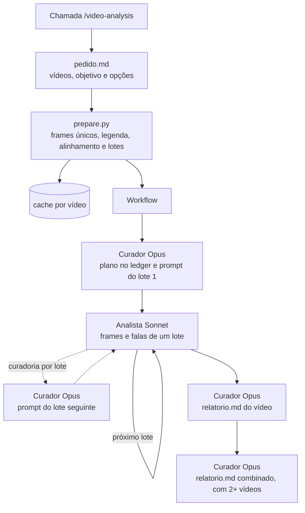

# video-analysis

Skill do Claude Code que analisa vídeos frame a frame contra a legenda: gravações de tela, reuniões
gravadas (Teams, Zoom) e aulas com slides. Você dá um objetivo, como "liste as decisões e os
responsáveis" ou "o que aparece na tela quando falam do erro?", e recebe um relatório por vídeo em que
cada achado aponta o frame e o horário que o sustentam.

**Versão 1.0.0** · Windows · Python 3.10+ · ffmpeg · Claude Code com a ferramenta Workflow

## Visão geral

- Extrai só os frames únicos do vídeo. Movimento do cursor, tooltip e relógio não contam, e uma tela que
  volta é reaproveitada em vez de virar frame novo.
- Lê a legenda `.vtt` de mesmo nome (WhisperX, Teams ou simples) e liga cada frame às falas do intervalo
  que ele representa.
- Divide cada vídeo em lotes de até 20 frames. Um curador (Opus) planeja os lotes e um analista (Sonnet)
  examina cada um, em série.
- Entrega um `relatorio.md` por vídeo e, com dois vídeos ou mais, um relatório combinado.
- Guarda frames, legenda e lotes em cache: uma pergunta nova sobre o mesmo vídeo não extrai nada de novo.

## Como funciona

A skill tem duas camadas.

1. **Determinística** (`scripts/`, Python). O `prepare.py` decodifica o vídeo uma vez com o ffmpeg, a 2
   quadros por segundo, e compara cada amostra, em cinza e com 360 px de altura, com o último frame
   mantido. Fica só o que mudou de verdade, cada frame com o intervalo de tempo que representa e um JPEG
   com lado maior de 1568 px. Depois ele lê a legenda, corrige e funde as falas, alinha as falas aos
   frames e escreve os lotes: a linha do tempo de cada lote (`batch_NNN.md`), uma prancha de miniaturas e
   a transcrição.
2. **Agêntica** (`workflow/` e `agents/`). Um Workflow do Claude Code conduz os lotes de cada vídeo em
   série, com até 3 vídeos em paralelo. O curador lê o objetivo e a transcrição, registra o plano num
   ledger e escreve o prompt do primeiro lote. O analista abre todas as imagens de um lote, cruza com as
   falas e grava o relatório do lote. No fim, o curador escreve o relatório do vídeo e, com dois vídeos
   ou mais, a síntese.



O desenho economiza tokens em três pontos:

- O agente principal nunca abre frames, lotes nem relatórios de lote. Ele só vê o JSON do `prepare.py`
  e os resumos finais.
- Só frames únicos vão para análise. Nas medições do projeto, de 66% a 91% das amostras foram
  descartadas.
- A transcrição é lida uma vez, pelo curador, e resumida no ledger.

Cada vídeo usa um analista por lote, mais o plano e o relatório; com dois vídeos ou mais, um agente a
mais escreve o relatório combinado. Com `--curadoria lotes`, o curador também escreve o prompt de cada
lote seguinte, o que custa cerca do dobro. Acima de 80 agentes, a skill pergunta antes de seguir;
acima de 800, recusa o run.

## Requisitos

| item | versão | para quê |
|---|---|---|
| Windows | desenvolvida no Windows 11 | caminhos, permissões e mensagens da skill são do Windows |
| Claude Code | com skills e a ferramenta Workflow | sem Workflow, a skill conduz o mesmo laço com a ferramenta Agent ([`reference/sem-workflow.md`](reference/sem-workflow.md)) |
| Python | 3.10 ou mais novo (testada no 3.14) | camada determinística |
| ffmpeg e ffprobe | no PATH (testada no 8.1) | sondagem e extração de frames |
| numpy e Pillow | qualquer versão recente | comparação de frames e imagens; a skill não usa OpenCV |
| Node.js | 24 | só para os testes do workflow |
| pytest | qualquer versão recente | só para os testes |

## Instalação

1. Clone o repositório na pasta de skills do Claude Code. A pasta precisa se chamar `video-analysis`:

   ```powershell
   git clone https://github.com/rmmaf/video-analysis-skill.git "$env:USERPROFILE\.claude\skills\video-analysis"
   ```

2. No Claude Code, rode o setup:

   ```text
   /video-analysis setup
   ```

   O setup roda o `verificar_ambiente.py` e resolve um item de cada vez: Python, ffmpeg, numpy e Pillow,
   a pasta central, os agentes e o workflow, e as regras de permissão. Nada é instalado nem gravado sem
   a sua confirmação. Fora da pasta central, ele grava em três lugares:

   | o quê | onde | como desfazer |
   |---|---|---|
   | os papéis do curador e do analista | `%USERPROFILE%\.claude\agents\video-analysis-*.md` | apagar os dois arquivos |
   | o workflow salvo | `%USERPROFILE%\.claude\workflows\video-analysis.js` | apagar o arquivo |
   | as regras de permissão da pasta central | `%USERPROFILE%\.claude\settings.json` | restaurar o `settings.json.bak-<data>` |

3. Feche e abra o Claude Code, para ele carregar os agentes e o workflow. Comece por uma análise curta,
   com `--max-lotes 1`: ela confirma que o run não pede permissão a cada frame.

**Para atualizar**, puxe as mudanças e rode o setup de novo, que recopia os agentes e o workflow quando
eles mudaram:

```powershell
git -C "$env:USERPROFILE\.claude\skills\video-analysis" pull
```

## Uso

Na conversa do Claude Code:

```text
/video-analysis "C:\Videos\reuniao.mp4" Liste as decisões tomadas e quem ficou responsável por cada uma
/video-analysis "C:\Videos\aulas" Resuma cada aula em passos numerados --max-lotes 2
/video-analysis "C:\Videos\demo.mp4" Que erro aparece na tela quando falam do deploy? --trecho 00:10:00-00:20:00
/video-analysis retomar
```

- Cada vídeo precisa de uma legenda `.vtt` com o mesmo nome, na mesma pasta: `reuniao.mp4` usa
  `reuniao.vtt`.
- Formatos aceitos: `.mp4`, `.mkv`, `.mov`, `.webm`, `.m4v`, `.avi`, `.wmv`, `.mpg`, `.mpeg`, `.ts`,
  `.m2ts` e `.flv`.
- Ponha o caminho entre aspas. Assim a skill reconhece pastas e nomes com espaço.

O que acontece depois da chamada:

1. A skill grava o pedido e estima o tempo da extração.
2. O `prepare.py` extrai frames, legenda e lotes, ou os reaproveita do cache, e calcula quantos agentes o
   run vai usar. Com mais de 80, a skill pergunta antes de disparar o Workflow.
3. O Workflow roda em segundo plano, a cerca de 4 minutos por lote, e avisa quando termina.
4. A skill mostra o resumo de cada vídeo e o caminho dos relatórios.

`retomar` continua um run interrompido (Claude Code fechado, cota, erro) do ponto em que parou.

### Opções

| opção | padrão | efeito |
|---|---|---|
| `--max-lotes N` | todos | só os lotes 1 a N de cada vídeo, para testar o objetivo |
| `--trecho hh:mm:ss-hh:mm:ss` | vídeo inteiro | só esse trecho, com lotes próprios |
| `--paralelo N` | `3` | vídeos em paralelo; use `1` contra limite de taxa |
| `--curadoria plano\|lotes` | `plano` | `lotes`: curador antes de cada lote, levando o contexto adiante (≈ 2× o custo) |
| `--esforco-analista low\|medium\|high` | `high` | esforço do analista; `medium` custa ~13% menos e responde de forma menos completa |
| `--esforco-curador low\|medium\|high` | `high` | esforço do curador nos lotes, só com `--curadoria lotes` |
| `--papeis agents\|inline` | automático | `agents` usa os agentes instalados; `inline` passa os papéis no prompt e custa um pouco mais |
| `--idioma xx` | o do objetivo | idioma dos relatórios |
| `--falantes "SPEAKER_01=Nome;…"` | — | nomes reais dos falantes da legenda |
| `--sensibilidade low\|normal\|high` | `normal` | `high` pega mudanças menores e gera mais frames |
| `--ignorar-regiao x,y,w,h` | — | região do quadro, em frações, fora da comparação: webcam, relógio |

Quando mexer em cada uma e quanto custa: [`reference/parametros.md`](reference/parametros.md).

### Saídas

```text
%USERPROFILE%\video-analysis\
├── cache\<slug>-<fp8>\              legenda, frames e lotes de cada vídeo, reaproveitados entre runs
├── runs\<AAAAMMDD-HHMMSS>-<slug>\
│   ├── relatorio.md                 relatório combinado, com 2+ vídeos
│   └── v1\                          relatorio.md do vídeo, ledger.md, prompts\ e reports\
├── pedidos\                         pedido da análise em curso
├── roles\                           cópia dos papéis para o modo inline
└── logs\
```

Os agentes só leem o cache e só gravam em `runs\`. Mover, renomear ou editar um vídeo faz ele ser
extraído de novo; mudar o objetivo, não.

## Ferramentas de linha de comando

Para uso manual, sem o Claude, a partir da pasta da skill:

```powershell
python scripts/prepare.py "C:\Videos\reuniao.mp4"                      # só aquece o cache
python scripts/prepare.py --gc 30                                       # apaga do cache vídeos sem uso há 30 dias
python scripts/explain.py --frames-json <frames.json> --frame F0042     # por que esse frame foi mantido
python scripts/calibrate.py "C:\Videos\reuniao.mp4" --grid "sensitivity=normal,high"   # compara parâmetros
python verificar_ambiente.py                                            # confere o ambiente, sem mudar nada
```

`python scripts/prepare.py --help` lista todas as opções. O `frames.json` de um vídeo fica em
`cache\<slug>-<fp8>\frames-<h8>\`.

## Testes

Rode a partir da pasta da skill:

```powershell
python -B -m pytest -q                  # unitários e vídeos sintéticos
python -B -m pytest -q --run-real       # inclui os vídeos reais de tests/fixtures.json
python -B -m pytest -q --run-slow       # inclui os testes de desempenho
node tests/harness.mjs                  # o workflow, com agentes simulados
python tests/check_run.py <run_dir>     # confere um run concluído
```

- O `-B` e o `pytest.ini` mantêm `__pycache__` e `.pytest_cache` fora da pasta da skill.
- `--run-real` e `--run-slow` também ligam com `VA_RUN_REAL=1` e `VA_RUN_SLOW=1`.
- Os vídeos sintéticos (`tests/synth.py`) são gerados com Pillow e x264, com gabarito, e ficam em cache em
  `%TEMP%\va-synth-v<N>` (ou em `VA_SYNTH_DIR`).
- O `harness.mjs` roda o `workflow/video-analysis.js` com agentes simulados: caminho feliz, lote que pula
  frames, falhas, retomada, vários vídeos e os dois modos de papéis. Não tem dependências.
- O `check_run.py` confere o ledger, se os prompts citam os lotes sem copiar falas, se os relatórios
  cobrem todos os frames e se o relatório final responde ao objetivo. As checagens do ledger e dos
  prompts seguem a curadoria do run (`options.curation`). No padrão `plano`, `Integrado até o lote`
  pode ir de `000`, como o INIT o grava, até o último lote analisado, e só o prompt do lote 1 é
  exigido; os dos outros lotes são conferidos quando existem. Com `--curadoria lotes`, o ledger tem de
  estar integrado até o penúltimo ou o último lote analisado, e cada lote precisa do seu prompt. Um run
  sem `options.curation` é anterior à opção, tinha o NEXT e é conferido como `lotes`.
- `tests/test_vtt.py` e `tests/test_data_files.py` leem trechos reais de legenda que ficam fora do git
  (veja [Dados e privacidade](#dados-e-privacidade)). Num clone novo, esses testes falham por falta dos
  arquivos.

## Solução de problemas

O `prepare.py` diz o que houve pelo código de saída:

| saída | significado |
|---|---|
| `0` | ok, às vezes com avisos |
| `2` | entrada: vídeo ou legenda não encontrados, pedido ou opção inválidos, run grande demais |
| `3` | ambiente: falta ffmpeg, ffprobe, Python, numpy ou Pillow; rode `/video-analysis setup` |
| `4` | um vídeo falhou; os outros seguem |
| `130` | interrompido; o que ficou pronto continua no cache |
| `1` | erro interno; o traceback fica em `logs\` |

Sintomas, causas e soluções, incluindo permissões, agentes e Workflow:
[`reference/problemas.md`](reference/problemas.md).

## Dados e privacidade

- A skill não usa segredo nem login: trabalha com arquivos locais, o ffmpeg e o Python.
- Os agentes não copiam valores sensíveis que apareçam na tela ou na fala, como senha, token, chave,
  connection string, CPF, telefone ou e-mail pessoal. Eles registram só que o dado apareceu, em que
  frame e em que horário.
- Os trechos reais de reuniões usados nos testes ficam fora do git, pelo `.gitignore`: as legendas de
  `tests/data/vtt/`, menos a sintética `edge_cases.vtt`, e a transcrição alinhada em
  `docs/prior-art/da_1608/`. Eles só existem na máquina de origem; a regra está em
  [`tests/data/vtt/README.md`](tests/data/vtt/README.md).
- O `.gitattributes` desliga a conversão de fim de linha dos `.vtt`, que os testes leem byte a byte.

## Limitações conhecidas

- **Feita para um usuário do Windows.** `SKILL.md`, `setup.md` e os arquivos de `reference/` citam
  caminhos absolutos em `C:\Users\digom\`. Em outro usuário, troque esses caminhos; o código Python usa
  `%USERPROFILE%` ou a variável `VIDEO_ANALYSIS_HOME`.
- **Troca só de cor não vira frame.** A comparação é em tons de cinza: uma cor nova com o mesmo brilho
  passa despercebida.
- **Mudanças minúsculas podem passar por cursor.** Um dígito ou poucas letras podem não virar frame;
  `--sensibilidade high` reduz isso.
- **Vídeos longos custam caro e demoram.** Uma reunião de 55 minutos dá cerca de 50 lotes, e os lotes de
  um vídeo rodam em série. Use `--trecho` ou `--max-lotes`.
- **Sem legenda, não há análise.** Sem a `.vtt` de mesmo nome, o `prepare.py` para, mostra os arquivos
  candidatos e sugere o comando para renomear.

## Próximos passos

Fora do escopo da versão 1, segundo o [plano](docs/plano.md):

- cobertura por relevância: o curador pula lotes alheios ao objetivo, o maior ganho em reuniões longas;
- curadoria a cada 2 lotes em trechos homogêneos;
- capítulos paralelos para um vídeo longo;
- recorte em resolução nativa para texto miúdo;
- comparação também em cor;
- empacotar como plugin, para registrar os agentes sem copiar arquivos nem reiniciar o Claude Code.

## Versões

| componente | versão | constante em `scripts/va/__init__.py` |
|---|---|---|
| skill | `1.0.0` | `VERSION` |
| extração e deduplicação de frames | `dedup-1.1` | `ALGO_VERSION` |
| parser de legenda | `vtt-1.0` | `PARSER_VERSION` |
| alinhamento, lotes e renderização | `render-1.1` | `RENDER_VERSION` |
| contrato `workflow_args` | `1` | `SCHEMA_VERSION` |

As versões dos estágios entram nas chaves do cache: mudar uma delas refaz só o estágio afetado e os
seguintes.

## Documentação

| arquivo | conteúdo |
|---|---|
| [`SKILL.md`](SKILL.md) | instruções que o Claude segue ao chamar a skill |
| [`setup.md`](setup.md) | roteiro do `/video-analysis setup` |
| [`reference/contratos.md`](reference/contratos.md) | formatos do pedido, do stdout do `prepare.py`, dos `workflow_args` e da pasta central |
| [`reference/parametros.md`](reference/parametros.md) | o que cada parâmetro faz e quando mexer |
| [`reference/problemas.md`](reference/problemas.md) | sintoma, causa e o que fazer |
| [`reference/sem-workflow.md`](reference/sem-workflow.md) | o mesmo laço com a ferramenta Agent, sem Workflow |
| [`docs/plano.md`](docs/plano.md) | plano, arquitetura e erratas da implementação |
| [`docs/design-deterministico.md`](docs/design-deterministico.md) | especificação da camada determinística (em inglês) |
| [`docs/design-agentico.md`](docs/design-agentico.md) | especificação da camada agêntica (em inglês) |
| [`tests/data/calibration.md`](tests/data/calibration.md) | medições que calibraram os parâmetros |

## Estrutura do repositório

```text
video-analysis/
├── SKILL.md                 instruções da skill para o Claude Code
├── setup.md                 roteiro do setup
├── verificar_ambiente.py    confere Python, ffmpeg, agentes, workflow e permissões
├── agents/                  papéis do curador (Opus) e do analista (Sonnet)
├── workflow/                video-analysis.js, o script do Workflow
├── scripts/
│   ├── prepare.py           linha de comando da camada determinística
│   ├── calibrate.py         varredura de parâmetros do motor de frames
│   ├── explain.py           painel de por que um frame foi mantido ou ignorado
│   └── va/                  extração, deduplicação, legenda, alinhamento, lotes, cache e runs
├── reference/               contratos, parâmetros, problemas e o roteiro sem Workflow
├── docs/                    plano, especificações e o protótipo anterior (prior-art)
└── tests/                   pytest, vídeos sintéticos, harness do workflow e dados de teste
```

## Licença

Repositório privado, de uso pessoal. Não há licença definida: sem um arquivo `LICENSE`, todos os
direitos ficam com o autor.
